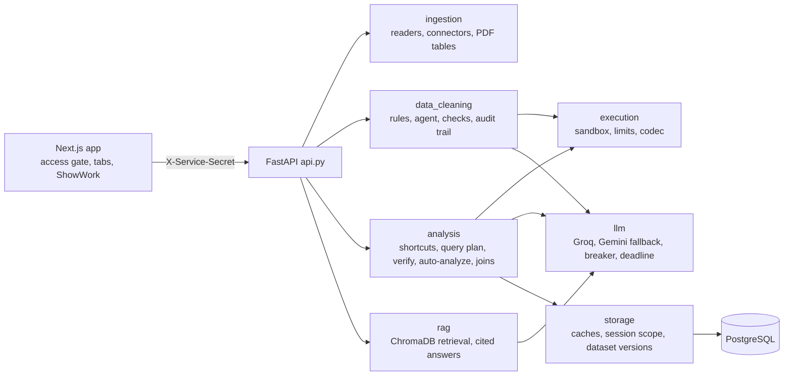

# AI Assistant for Data Analysis

Ask plain-English questions about a spreadsheet and get numbers you can check. The assistant is built around one rule: **a wrong number must never be shown as verified.** A language model decides *what* to compute; code that our side controls computes it, a second independent computation checks it, and every answer says how it was produced.

<p>
  
  
  
  
  
  
</p>

| | |
|---|---|
| Automated test modules | **87**, all offline (no network, no API key) |
| Eval gate | **56** hand-checked questions over 4 datasets: 56 correct, **0 wrong answers shown as verified** |
| Adversarial suite | **91** attack checks: query-plan, sandbox, prompt injection, hijacked model, cross-session, resource |
| Double computation | **10 of 10** injected engine faults caught; no false alarms over **2,500** random plans |

---

## Contents
1. [Design: five hazards and their controls](#design-five-hazards-and-their-controls)
2. [Features](#features)
3. [Architecture](#architecture)
4. [Getting started (Windows)](#getting-started-windows)
5. [Configuration](#configuration)
6. [Testing and evaluation](#testing-and-evaluation)
7. [API](#api)
8. [Known limitations](#known-limitations)

---

## Design: five hazards and their controls

The system was designed hazard-first: name what must never happen, state the rule that prevents it, enforce the rule at one place in the code, and keep a test that proves it.

| # | Hazard | Control | Proof |
|---|---|---|---|
| H1 | A wrong number is shown as verified | Typed query plans, double computation, the eval gate, a dropped-condition guard | `tests/analysis/test_plan_verify.py`, `python -m evaluation.eval_gate` |
| H2 | One user's data reaches another | Every cache, cached model answer and dataset version is scoped to a session; a wrong session gets the same "not found" as a missing item | Part 4 of the adversarial suite, `tests/storage/test_dataset_store.py` |
| H3 | Generated code reaches secrets or the host | Hardened sandbox: AST checks, allowlist proxies, reduced environment, OS memory cap, pickle-free result channel | `tests/execution/`, sandbox cases S01–S18 |
| H4 | Data is changed without a record | Immutable dataset versions in PostgreSQL; database triggers refuse UPDATE, DELETE and TRUNCATE | `tests/storage/test_dataset_store.py` |
| H5 | A user or a failing provider exhausts the service | Upload and rate limits, a circuit breaker per model provider, Groq-to-Gemini failover, one deadline per request | Part 5 of the adversarial suite, `tests/llm/test_resilience.py` |

### How an answer is produced

1. **Shortcut** — whole-column questions ("total revenue") are answered by fixed code, no model.
2. **Typed query plan** — for most questions the model writes a small JSON plan (`select`, `filters`, `group_by`, `order_by`, `limit`), not code. Our validator checks every column and operator, then compiles it to **parameterised DuckDB SQL** with identifiers quoted by us and external file access off. The model's text never becomes SQL.
3. **Double computation** — the same plan is recomputed with pandas by a module that shares no code with the SQL compiler, and checked against invariants (group counts add up to the row count, min ≤ average ≤ max). Only if both agree is the answer labelled **cross-checked**. If they disagree, the answer is withheld.
4. **Guards on the plan** — group columns are always included in grouped results, and a question that says "excluding" / "except" / "without" is never called cross-checked if the plan has no filter.
5. **Python fallback** — questions the plan language cannot express go to model-written pandas code run in the sandbox. Those answers are labelled *"Computed by AI-written pandas code, run in the sandbox"* and are never called cross-checked.

Every answer has a **"How this was computed"** panel with the exact plan, SQL or code that ran.

---

## Features

### Spreadsheet analysis
- **Upload** CSV, TXT, XLSX and XLS. Multi-sheet workbooks: the real data sheet is picked over dashboard or summary tabs. Files over 50 MB are queried through DuckDB's own CSV engine instead of being loaded into pandas.
- **Import from a source**: a public Google Drive file or folder, or a MySQL table (private hosts are refused when the service is hosted).
- **Dataset profile**: rows, columns, numeric columns, blank cells, and a PII report shown before any AI step.
- **Ask a question**: plain English in; a table, number or chart out (see *How an answer is produced*).
- **Auto-analyze**: up to five ranked findings built in four steps — the model plans computations (no numbers), the sandbox computes them, the model writes findings from those results only, and a verifier checks that every number in a finding matches a computed result. Failing findings are dropped and the count is shown. Up to three charts follow.
- **Grounded follow-up questions**: the model first decides whether a real number is needed, and computes it before answering.
- **PDF report** of findings, charts and follow-ups, generated in the browser.

### Cleaning, with a record of every change
- **Rule-based cleaning**, run only when the user opts in: currency symbols, percentages, thousands separators, dates, spelling variants of one category, identifier columns kept as text so postal codes are never averaged. Blank cells are **reported, never invented**.
- **Duplicates are reported, removed only on request**; rows that repeat a unique record ID are merged, keeping the most complete copy. The log only states what is still in the table.
- **Data checks**: impossible negatives, future dates, end-before-start, mixed date formats, encoding damage.
- **Data Quality Agent** (optional AI step): diagnoses defects a fixed rule can't catch, writes a fix that runs in the sandbox, and validates the result before keeping it.
- **Fill missing values from evidence in the table only**: a value another column proves (every row of one customer has the same postal code), or an exact formula (`amount = quantity × unit_price`). Dates and IDs are never filled; text with no evidence stays blank; a median fill happens only on request. Every fill is reported.
- **Scale review**: a few values exactly 1000× the rest of a whole-number column (5000 among 1–20) are flagged, and divided by 1000 only when the user clicks.
- **Audit trail**: every change the cleaners made, filterable in a dashboard and downloadable as CSV.

### Documents (beta)
- Index PDF, DOCX, TXT and Markdown for question answering. Answers cite `(Passage N)` and list the passages, and say so when the document doesn't contain the answer.
- Ranked key insights from a document, and **tables inside PDFs** are extracted and sent through the same spreadsheet pipeline.

### Join datasets (beta)
- Upload two or more files, give each an alias, and ask one question across them. Answered with real SQL joins in DuckDB inside the sandbox.

### Security and operations
- **Sandbox** for model-written code: an AST check refuses `import`, dunder access and dangerous attributes (including names built at runtime); pandas, NumPy, Plotly and DuckDB objects are reached only through attribute-allowlist proxies; the worker runs with a reduced environment (no API keys), an OS-enforced memory cap (Windows Job Object, Unix `RLIMIT_AS`) and a timeout; results come back over a strict JSON/Parquet/NumPy codec, never pickle.
- **Prompt-injection fence**: uploaded text sits between randomly tagged markers, and marker look-alikes in the data are removed, including Unicode disguises (zero-width spaces, full-width letters, soft hyphens).
- **PII protection**: checksum-validated detection (cards, Aadhaar, PAN, UPI, SSN, email, phone); columns named like personal data are withheld from every prompt by default.
- **Tamper-evident audit log**: JSONL chained with SHA-256; stores no request bodies, prompts or data values.
- **Rate limits** per session and per IP, upload size caps, a daily model-call budget, and an **access code** gate in the web app.
- **Versioned datasets** (optional, PostgreSQL or SQLite): every upload and cleaned table is stored as a numbered, SHA-256-addressed version with its parent; every answer records which version it was computed from.
- **Resilience**: a circuit breaker per provider (opens after 3 failures in a row, 60 s cooldown, one trial call), automatic failover from Groq to Gemini, and one deadline per request (120 s) that caps every model call. Answers from the second provider are flagged `llmFallbackUsed`.

---

## Architecture



### Backend packages (`AST 2.0/`)

| Package | Job |
|---|---|
| `api.py` | HTTP routes, shared-secret check, error scrubbing |
| `ingestion/` | File readers, encoding detection, Google Drive and MySQL connectors, PDF table extraction |
| `data_cleaning/` | Rule-based cleaning, Data Quality Agent and its prompts, data checks, fill and scale services, audit trail |
| `analysis/` | Question answering: shortcuts, typed query plan, independent verifier, auto-analyze, multi-table joins, profiler |
| `execution/` | Sandbox: AST guard, proxies, subprocess limits, result codec |
| `llm/` | Model calls, caching, daily budget, fallback provider, circuit breaker, request deadline |
| `rag/` | Document indexing and cited answers |
| `security/` | Rate limiter, PII redaction, prompt-injection fence |
| `storage/` | Caches, session-scoped storage, local uploads, versioned dataset store |
| `audit/` | Hash-chained audit log and the change ledger |
| `evaluation/` | Eval harness, eval gate, cleaning benchmark — measures the rest, imported by nothing |
| `tests/` | One folder per package, plus `tests/architecture/` |

**Dependency rules are tested.** `tests/architecture/test_package_boundaries.py` reads every import (including ones inside functions) and fails on any package dependency not in its map, on any stale map entry, and on any new cycle. Leaf packages (`audit`, `llm`, `storage`) import nothing else; `security` and `execution` use only `audit`. One cycle is accepted and documented: `ingestion` ↔ `data_cleaning` (the file reader applies the cleaning package's missing-value rules).

### Frontend (`AST NextJS/`)
- `app/page.tsx` — three tabs: Spreadsheet Analysis, Documents, Join Datasets. `app/access/` — the access-code gate.
- `app/api/*` — one route per backend endpoint; each forwards to the Python service with the shared secret. Uploads are streamed, never buffered.
- `components/` — query panel, result display, `ShowWork` ("How this was computed"), auto-analyze report, cleaning and audit dashboards, document Q&A.
- `lib/` — Python client, session id, access gate, PDF report.

---

## Getting started (Windows)

Requirements: Python 3.11+, Node.js 18+, a free [Groq API key](https://console.groq.com). Optional: a Gemini API key (second provider) and PostgreSQL (versioned datasets).

**Backend** (Command Prompt):
```bat
cd "AST 2.0"
python -m venv astfs
astfs\Scripts\activate
pip install -r requirements.txt
copy .env.example .env
```
Edit `.env`: set `GROQ_API_KEY` and `PYTHON_SERVICE_SECRET` (generate one with `python -c "import secrets; print(secrets.token_urlsafe(32))"`). Then:
```bat
uvicorn api:app --reload --port 8000
```

**Frontend** (a second window):
```bat
cd "AST NextJS"
npm install
copy .env.example .env.local
npm run dev
```
Edit `.env.local`: `PYTHON_SERVICE_URL=http://localhost:8000`, the **same** `PYTHON_SERVICE_SECRET` as the backend, and an `ACCESS_CODE` (the gate is off locally when it is unset, and locked in production when it is unset). Open http://localhost:3000.

**Versioned datasets (optional).** Create a database (for example `ast` in pgAdmin) and add to `AST 2.0\.env`:
```
DATABASE_URL=postgresql://postgres:<password>@localhost:5432/ast
```
Write special characters in the password URL-encoded (`@` → `%40`). Restart the API; the tables `datasets`, `dataset_versions` and `answers` are created on the first recorded answer. `GET /admin/stats` shows whether the store is active.

---

## Configuration

All settings are environment variables in `AST 2.0\.env` (see `.env.example`).

| Variable | Default | Effect |
|---|---|---|
| `GROQ_API_KEY` | — | Primary model provider (required) |
| `GROQ_CODE_MODEL` / `GROQ_CHAT_MODEL` | `openai/gpt-oss-20b` / `openai/gpt-oss-120b` | Models for code/plans and for prose |
| `PYTHON_SERVICE_SECRET` | — | Shared secret with the web app (required) |
| `GEMINI_API_KEY` | unset | Turns on Gemini as the second provider |
| `GEMINI_MODEL`, `GEMINI_CODE_MODEL`, `GEMINI_CHAT_MODEL` | `gemini-3.8-flash` | Gemini model overrides |
| `GEMINI_REASONING_EFFORT` | `low` | Keeps hidden thinking from crowding out the answer |
| `FALLBACK_LLM_BASE_URL`, `FALLBACK_LLM_API_KEY`, `FALLBACK_CODE_MODEL`, `FALLBACK_CHAT_MODEL` | unset | Any OpenAI-compatible second provider; wins over the Gemini preset |
| `LLM_BREAKER_FAILURES` / `LLM_BREAKER_COOLDOWN_S` | 3 / 60 | Circuit breaker |
| `REQUEST_DEADLINE_S` | 120 | Time budget per request across all model calls |
| `LLM_DAILY_CALL_LIMIT` | 400 | Model calls per day before refusing |
| `AST_QUERY_PLAN` | 1 | `0` turns off the typed-plan route |
| `DATABASE_URL` / `AST_DATASET_DB` | unset | Versioned dataset store: PostgreSQL URL, or a SQLite file path |
| `DATASET_STORE_MAX_MB` | 50 | Largest table stored as a version |
| `MAX_UPLOAD_MB` / `LOCAL_UPLOAD_TTL_HOURS` | 200 / 24 | Upload size cap; hours before an upload is deleted |
| `LOCAL_UPLOAD_DIR` | temp folder | Where uploads are kept |
| `RATE_LIMIT_ENABLED` / `RATE_LIMIT_MULTIPLIER` | 1 / 1 | Rate limiting on/off; scale all limits |
| `TRUSTED_PROXY_HOPS` | 0 locally, 1 hosted | Proxies to trust for `X-Forwarded-For` |
| `CACHE_ENABLED` / `CACHE_TTL_SECONDS` | 1 / 1800 | Caches on/off; entry lifetime |
| `CACHE_BLOB_MB` / `CACHE_FRAME_MB` / `CACHE_RESULT_MB` | 64 / 96 / 16 | Cache memory budgets |
| `PII_WITHHOLD_PERSONAL_COLUMNS` | 1 | `0` sends personal-named columns to the model (not recommended) |
| `PII_USE_NER` | off | `1` enables the optional spaCy name detector |
| `AUDIT_LOG_PATH` | `logs/audit.jsonl` | Audit log file |
| `AUDIT_LOG_CODE` / `AUDIT_LOG_STDOUT` / `AUDIT_LOG_DISABLED` | off | Also log executed code / echo to stdout / turn off |
| `GOOGLE_API_KEY` | unset | Lists Drive folders through the official API |
| `DRIVE_FOLDER_MAX_FILES` / `DRIVE_IMPORT_BUDGET_S` | 12 / 90 | Drive folder import limits |
| `MYSQL_IMPORT_MAX_ROWS` / `CONNECTOR_TIMEOUT_S` | 200000 / 30 | MySQL import limits |
| `ALLOW_PRIVATE_DB_HOSTS` | auto | Allow private/loopback database hosts (off when hosted) |
| `APP_ENV` | — | `production` applies hosted-mode rules |
| `SANDBOX_LOCAL_FAST_MODE` | off | Skips the sandbox subprocess. **Local debugging only**; prints a warning |

Web app (`AST NextJS\.env.local`): `PYTHON_SERVICE_URL`, `PYTHON_SERVICE_SECRET`, `ACCESS_CODE`.

---

## Testing and evaluation

From `AST 2.0` with the virtual environment active:

```bat
python run_tests.py                          :: all 87 test modules, offline
python run_tests.py storage llm              :: only modules whose name contains these words
python -m tests.security.test_adversarial_suite
python -m evaluation.eval_gate               :: release gate (replays recorded model answers)
```

- **Offline by design.** `run_tests.py` removes fallback-provider keys from every test's environment, and `tests/llm/test_offline_suite.py` fails if a test could reach a real provider.
- **Golden test.** `tests/data_cleaning/test_na_policy_golden.py` freezes the cleaned output of every eval file; its hashes are for pandas 3.0.5 (it skips on other versions).
- **PostgreSQL.** The dataset-store test runs on SQLite by default. To also run it on a real server: `set AST_TEST_DATABASE_URL=postgresql://postgres:<password>@localhost:5432/postgres` before running it. It creates and drops its own temporary schema.

### Eval gate (release check)

`python -m evaluation.eval_gate` replays recorded model responses (`eval_data/gate/cassettes/`) for 56 questions with hand-computed answers, so it runs offline and gives the same result every time. Each answer is scored as verified-correct, verified-wrong, unverified-correct, unverified-wrong, abstained or failed. The gate **fails on any verified-wrong answer**, on fewer correct answers than `baseline.json`, on a prompt change that misses the recordings, or on a changed question set.

| Exit code | Meaning |
|---|---|
| 0 | Pass |
| 1 | Gate failed |
| 2 | Not recorded yet / bad config |
| 3 | Recording incomplete |
| 4 | Recorded run contains a verified-wrong answer |

Re-record (needs `GROQ_API_KEY`): `python -m evaluation.eval_gate --record`.

Its first run found **8 of 56 answers wrong but labelled cross-checked** — both engines had correctly computed a plan for the wrong question. Root-cause fixes (group labels always included, a rule that routes wide tables to the Python path, the dropped-condition guard) brought it to **56 of 56 correct, 0 verified-wrong** (36 cross-checked, 20 correct but unverified).

### Other evaluations

```bat
python -m evaluation.eval_harness --init-template mydata.csv     :: starter questions from your columns
python -m evaluation.eval_harness --dataset mydata.csv --questions questions.csv --repeat 3
python -m evaluation.eval_heldout       :: held-out accuracy on three messy files (47 questions)
python -m evaluation.eval_insights      :: auto-analyze: findings dropped by the verifier, independent re-check
python -m evaluation.eval_rag           :: documents: cites a passage, grounded, refuses unanswerables
python -m evaluation.eval_joins         :: join accuracy incl. fan-out and orphan traps
python -m evaluation.clean_score --adapter stage0   :: cleaning benchmark
```
`eval_data/sample_*.csv` is the dev set (tuned against; catches regressions only). `eval_data/heldout/` is the held-out set; its answers are computed from the clean data before it is corrupted (`python -m eval_data.heldout.build_heldout`).

---

## API

All routes are `POST` unless noted, take JSON, and require the `X-Service-Secret` header. Files are referenced by the `local://…` id returned from `/upload`, and requests carry the browser's `sessionId`.

| Route | Purpose |
|---|---|
| `/upload` | Stream a file in; returns its id |
| `/connect/google-drive`, `/connect/mysql` | Import from Google Drive or a MySQL table |
| `/profile` | Dataset profile and PII report |
| `/analyze` | Answer a question (shortcut → plan → Python fallback) |
| `/auto-analyze`, `/auto-analyze/follow-up` | Verified findings and charts; grounded follow-ups |
| `/clean`, `/clean/agent`, `/clean/fill`, `/clean/scale` | Rule cleaning, AI cleaning, exact fills, scale review |
| `/data-checks` | Value checks (negatives, dates, encoding) |
| `/clean/audit`, `/clean/audit/csv`, `/clean/duplicates` | Audit trail, its CSV, remove-duplicates choice |
| `/multi-table/query` | Question across several aliased datasets |
| `/rag/index`, `/rag/query`, `/rag/insights` | Document indexing, cited Q&A, key insights |
| `GET /health` | Liveness |
| `GET /admin/stats` | Cache hit rates, limiter counters, audit-chain status, circuit breakers, dataset store status |

---

## Known limitations

- **"Cross-checked" proves the arithmetic, not the understanding.** If the model writes a plan for a different question, both engines agree on the wrong question. The eval gate measures how often; two guards cover the known patterns.
- **The Python fallback can answer a question the data can't support.** Asked for a "profit margin" on data with no cost column, it may invent a definition. Such answers are never labelled cross-checked, but they are not refused either.
- **The test set is the tuning set.** 56 of 56 shows the fixes hold on those questions; it is not an accuracy estimate for new questions.
- **36% of gate answers are unverified** (Python route or shortcut): correct on this set, but without a second computation.
- **Sessions are not users.** There is no login; anyone holding a session id is that session. Isolation is between sessions.
- **The sandbox is a hardened process, not a container or VM.**
- **Prompt injection is reduced, not solved**; a model that obeys injected text still cannot get past the validator or the sandbox.
- **Rate limits, caches and breaker state are per process** and reset on restart.
- **Only the analysis path records dataset versions**; the cleaning endpoints don't. Versions are never deleted automatically, and a database administrator can drop the triggers.
- **The second provider is a different model**; the eval gate measured the primary model only.
- **Scanned PDFs** need OCR, which isn't implemented.

## License

Available for portfolio and educational reference.
