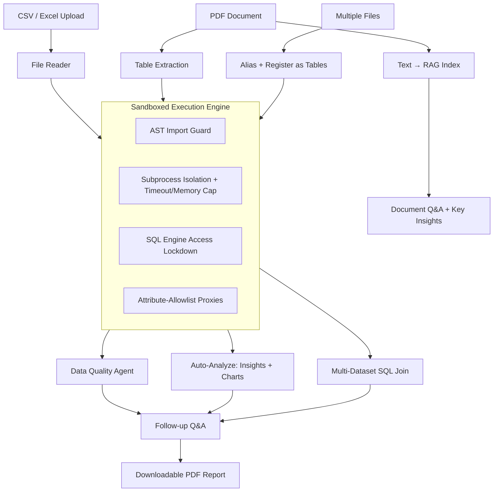

# Agentic AI Assistant for Data Analysis

An AI-powered data analysis platform that turns natural-language questions into real computation — not guessed numbers. It analyzes CSVs and Excel files, extracts and analyzes structured tables buried inside PDFs, and joins across multiple datasets with real SQL, all while every LLM-generated operation runs inside a sandboxed execution engine before it ever touches your data.

<p>
  
  
  
  
  
  
</p>

---

## Why this exists

Most "AI data analyst" demos let a language model write code and just... run it, or worse, let the model eyeball a table and describe what it thinks the numbers say. Both approaches produce answers that sound confident and are sometimes wrong in ways that are hard to catch.

This project takes a different position: **an LLM should decide what to compute, but a real, sandboxed execution engine should be the one to compute it.** Every insight, every chart, every follow-up answer, every SQL join is either the direct output of code actually running against your real data, or is explicitly labeled as something the data can't determine — never a plausible-sounding guess presented as fact.

## Key Features

### 📊 CSV / Excel Analysis
- **Multi-format ingestion** — CSV, XLSX, XLS, with automatic detection of the correct sheet in multi-sheet Excel workbooks (skips dashboard/summary tabs in favor of the real underlying data table).
- **Transparent, consent-based cleaning** — deterministic rule-based cleaning (currency symbols, percentages, thousands separators, identifier-column detection so postal codes and account numbers never get averaged) runs only after the user explicitly opts in, never silently.
- **Autonomous Data Quality Agent** — goes beyond null-filling. Diagnoses inconsistent category spellings ("USA" / "U.S." / "United States"), implausible outliers, structurally meaningful blanks (e.g. a deliberately empty "Total" row in a financial table), and other defects a fixed set of regexes can't catch — then proposes and applies fixes, with the full diagnosis kept as an inspectable audit trail.
- **Ask-a-question query panel** — natural language in, real pandas/Plotly code out, executed in the sandbox, returned as a table, chart, or scalar.
- **Auto-Analyze** — five ranked business insights, each paired with a concrete recommended action, plus up to three charts the model chooses specifically to make those insights visible at a glance. Every chart is its own sandboxed execution, not a template.
- **Grounded follow-up Q&A** — ask a question about an insight or a business decision. The model first decides whether answering precisely needs a real number computed from the data; if so, it writes and runs that computation before answering. For open-ended "why" questions, it can explore several independent angles (pricing, order size, regional concentration) rather than stopping at one shot.
- **Downloadable PDF report** — a client-side generated report bundling insights, charts, and the follow-up conversation into a clean, print-ready document.

### 📄 Document Intelligence (RAG)
- Indexes PDFs, DOCX, and text documents for retrieval-augmented Q&A and auto-extracted key insights.
- **Structured data extraction** — detects real tables inside PDFs and routes them into the *same* CSV analysis pipeline used for uploads, rather than summarizing them as text. A number from a table inside a PDF gets the same real-computation guarantee as a number from an uploaded spreadsheet.

### 🔗 Multi-Dataset SQL Queries
- Upload two or more related datasets, give each a short alias, and ask one question that spans all of them.
- Real SQL — joins, aggregations, grouping — powered by an embedded analytical database, not a text summary stitched together from separate files.

### 🔒 Sandboxed Execution Engine
The architectural throughline underneath every feature above:
- All LLM-generated code and SQL runs in an **isolated subprocess** with wall-clock timeout and memory limits.
- An **AST-level guard unconditionally blocks every `import` statement** in generated code — there is no way for generated code to reach a module it wasn't explicitly handed.
- pandas/NumPy/Plotly objects and the SQL engine's connection are exposed through **attribute-allowlisting proxies** — only specific, vetted methods are reachable; everything else raises immediately.
- The SQL engine additionally runs with **external file and network access disabled at the engine level**, so a malicious query can't read arbitrary local files or make outbound network calls, regardless of how the query is phrased.

Three independent attack vectors were deliberately tested against the real sandbox, each caught by a **different** layer — not the same check three times:

| Attack | Caught by |
|---|---|
| Malicious SQL text reading a local file | SQL engine's own access-control configuration |
| Generated code trying to open a fresh, unrestricted connection | Connection proxy's attribute allowlist |
| Generated code trying to import the SQL library directly | AST-level import ban |

### 🛡️ Security Operations Layer
Defences you can inspect after the fact, not just trust:
- **Tamper-evident audit log** (`audit_log.py`) — JSONL, one record per security-relevant event (requests, sandbox blocks/timeouts, PII redactions, injection detections, auth failures, rate limits), chained with SHA-256 so edited, deleted or reordered lines are detected by `verify_chain()`. It never stores request bodies, prompts, dataset values or PII; URLs and IPs are hashed. This detects casual tampering only — ship the log off-box if that matters.
- **Rate limiting** (`rate_limiter.py`) — sliding-window limits keyed on session (heavy LLM endpoints 4/min + 30/hr, medium 20/min, light 30/min) plus a per-IP backstop; returns `429` with `Retry-After`. State is per-process in memory, so multiply limits by worker count.
- **PII protection** (`pii_redaction.py`) — checksum-validated detection (Luhn cards, Verhoeff Aadhaar), PAN, Indian mobile, UPI, SSN, email, phone. Columns *named* like personal data (name, email, phone, address, DOB...) are withheld from every LLM prompt by default. `/profile` returns a `piiReport` the UI shows before any AI step.
- **Caching** (`cache_layer.py`) — byte-bounded LRU+TTL caches for downloads, parsed/cleaned frames and deterministic `/profile` and `/clean` results, keyed on content hash. LLM-backed answers are deliberately never cached.
- **Found by its own evaluation harness:** running the harness against real model output exposed (1) a sandbox escape (`df._obj` returned the raw DataFrame, so generated code could write files) — now blocked at the AST layer and regression-tested; (2) the proxy had no operator support, so every filter (`df[df['x'] > 5]`) and derived column failed — fixed; (3) common pandas idioms (`idxmax`, `loc`, `iloc`, `isin`) were blocked — added behind a restricted indexer proxy; (4) the no-LLM shortcut layer answered "list regions ranked by total revenue" with the grand total — shortcuts now only fire for plain whole-column questions.
- **Evaluation harness** (`eval_harness.py`) — measures accuracy against ground-truth answers you compute independently, with Wilson 95% intervals, failure taxonomy, latency and repeat-consistency. See below.

## Architecture



## Tech Stack

**Frontend:** Next.js 15, React 19, TypeScript, Tailwind CSS, Plotly.js, jsPDF
**Backend:** FastAPI, Python, pandas, NumPy
**AI / LLM:** Groq-hosted Llama models, with dual-model routing (a fast model for code generation, a larger model for reasoning)
**Data engines:** DuckDB (SQL joins), ChromaDB (vector store for RAG)
**Document processing:** pdfplumber (table extraction), pypdf, python-docx
**Storage:** Uploaded files are stored on the backend's local disk (no cloud storage account needed)

## Project Structure

```
├── frontend/                    # Next.js app
│   ├── app/api/                 # API routes proxying to the Python backend
│   ├── components/              # CsvAnalysisTab, DocumentIntelligenceTab,
│   │                             # MultiTableTab, and their sub-components
│   └── lib/                     # Python service client, PDF report generator
│
└── backend/                     # FastAPI service
    ├── api.py                   # Route definitions
    ├── file_reader.py           # Unified CSV/Excel reader
    ├── cleaning.py               # Deterministic rule-based cleaning
    ├── cleaning_agent.py         # Autonomous data quality agent
    ├── analysis_service.py       # Single-dataset query engine
    ├── auto_analyze_service.py   # Insights + chart generation
    ├── multi_table_service.py    # Multi-dataset SQL joins (DuckDB)
    ├── table_extraction.py       # PDF table detection
    ├── rag_engine.py             # Document indexing + retrieval
    ├── sandbox.py                # AST-level safety guard
    ├── sandbox_proxy.py          # Attribute-allowlisting proxies
    ├── sandbox_limits.py         # Subprocess isolation, timeout, memory caps
    ├── audit_log.py              # Tamper-evident audit trail
    ├── rate_limiter.py           # Sliding-window rate limits
    ├── pii_redaction.py          # PII detection + personal-column withholding
    ├── cache_layer.py            # Bounded LRU/TTL caches
    ├── eval_harness.py           # Ground-truth accuracy evaluation
    └── test_*.py                 # run with: python3 test_<name>.py
```

## Getting Started

### Prerequisites
- Python 3.11+
- Node.js 18+
- A [Groq API key](https://console.groq.com)

### Backend

```bash
cd backend
python -m venv venv
source venv/bin/activate        # Windows: venv\Scripts\activate
pip install -r requirements.txt
```

Create a `.env` file:
```
GROQ_API_KEY=your_groq_api_key
PYTHON_SERVICE_SECRET=any_shared_secret_you_choose
```

Run the API:
```bash
uvicorn api:app --reload --port 8000
```

### Frontend

```bash
cd frontend
npm install
```

Create a `.env.local` file:
```
PYTHON_SERVICE_URL=http://localhost:8000
PYTHON_SERVICE_SECRET=same_secret_as_backend
```

Run the app:
```bash
npm run dev
```

## Configuration (optional environment variables)

| Variable | Default | Effect |
|---|---|---|
| `AUDIT_LOG_PATH` | `logs/audit.jsonl` | Audit log location (falls back to stdout if unwritable) |
| `AUDIT_LOG_CODE` | off | `1` also stores executed code (truncated) |
| `AUDIT_LOG_STDOUT` / `AUDIT_LOG_DISABLED` | off | Echo records to stdout / turn auditing off |
| `RATE_LIMIT_ENABLED` | on | `0` disables limiting |
| `RATE_LIMIT_MULTIPLIER` | 1 | Scales every limit (e.g. `2` per extra worker) |
| `CACHE_ENABLED` | on | `0` bypasses all caches |
| `CACHE_TTL_SECONDS` | 900 | Entry lifetime |
| `MAX_UPLOAD_MB` / `LOCAL_UPLOAD_TTL_HOURS` | 200 / 24 | Largest accepted upload; hours before an uploaded file is deleted |
| `CACHE_BLOB_MB` / `CACHE_FRAME_MB` / `CACHE_RESULT_MB` | 64 / 96 / 16 | Memory budgets |
| `PII_WITHHOLD_PERSONAL_COLUMNS` | on | `0` sends personal-named columns to the LLM (not recommended) |
| `PII_USE_NER` | off | `1` enables the optional spaCy name detector (needs `spacy` + a model; untested adapter) |

`GET /admin/stats` (secret-protected) reports cache hit rates, limiter counters and whether the audit chain is intact.

## Evaluating accuracy

```bash
python eval_harness.py --init-template mydata.csv     # starter questions from your real columns
# fill in `expected` BY HAND, independently of the assistant
python eval_harness.py --dataset mydata.csv --questions questions.csv            # needs GROQ_API_KEY
python eval_harness.py --dataset mydata.csv --questions questions.csv --repeat 3 # consistency
python eval_harness.py --dataset eval_data/sample_sales.csv --questions eval_data/sample_questions.csv --solver shortcut  # offline baseline
```
Results land in `eval_results/<timestamp>/` (`report.md`, `results.csv`, `summary.json`). Small question sets give wide intervals; the report prints them.

## Known Limitations

Being upfront about where this currently falls short, rather than overselling it:

- **Dataset size** — the pipeline loads files fully into memory (pandas), with a sandbox memory ceiling sized for typical exploratory datasets. Very large files (hundreds of MB+) can exceed that ceiling before hitting the nominal upload limit. Routing large-file analysis through the same DuckDB engine already used for multi-dataset joins — which can query files out-of-core without fully materializing them — is the planned fix.
- **LLM output format variance** — several parsing layers had to be hardened against real (not just hand-written test) model output using different separators, markdown styles, and multi-line layouts than expected. This is an ongoing category of risk with any LLM-output-parsing system, not a one-time fix.
- **PDF table extraction** works on text-based PDFs with real tabular structure; scanned/image-only PDFs would need OCR, which isn't currently implemented.
- **Rate limits and caches are per-process and in-memory** — they reset on restart and aren't shared across workers or serverless instances.
- **Personal-named columns are withheld from the LLM**, so the cleaning agent can't, for example, normalise spellings inside a `customer_name` column.
- **Serverless execution time limits** apply to very long-running analyses on hosted deployments; a background-job architecture would remove this ceiling but isn't currently in place.

## License

This project is available for portfolio and educational reference.
